<div align="center">

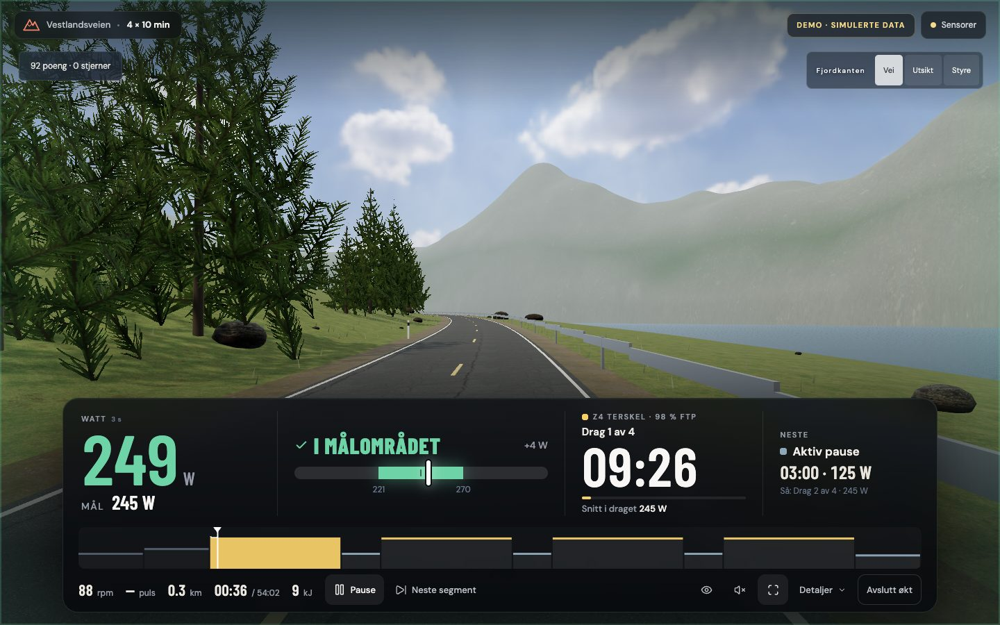

# SUMMIT

**Structured indoor cycling that runs in your browser.**<br>
Connect a Bluetooth bike or trainer, pick a workout, ride. No install, no account.

</div>

---

SUMMIT started as a way to make interval sessions on a basement spin bike less dull. Zwift is very good at the social side of indoor riding. SUMMIT focuses on the workout itself: hitting the number while you are tired, and understanding the ride afterwards.

It is built for bikes without automatic resistance control as well as smart trainers. When the bike cannot set the load for you, the screen has to tell you clearly what to do, so the ride cockpit is designed to be read from two metres away, mid-interval, in peripheral vision.

## Highlights

**Ride cockpit**
- Power as a 3-second average, next to a ±10 % target band. Instead of a raw number to interpret, it tells you what to do: *Øk 24 W* (push 24 W) or *Senk 18 W* (ease off 18 W).
- The screen edge glows green, blue or amber, so you know whether you are on target without looking at the numbers.
- Big 3‑2‑1 countdown with the next target, a short receipt after every completed interval, and the whole plan drawn with your actual power on top.
- Focus mode (`H`) hides every game element and leaves only the training.

**Training**
- 100 structured workouts across recovery, endurance, tempo, sweet spot, threshold, VO₂max, anaerobic and sprint.
- Workout builder: sets × reps with independent rests, by time or virtual distance.
- Ramp FTP test with strict validity rules. Pauses or data gaps invalidate the estimate instead of inflating it.

**After the ride**
- A full-page report: an honest one-line verdict, normalized power, IF and TSS calculated from measured watts, and an interactive power chart coloured by training zone.
- One card per interval, plus pacing feedback (*"power dropped 6 points from the first to the last interval"*).
- Weekly load for the last eight weeks, rolling 28-day comparison, and a mean-maximal power curve from 5 s to 60 min.
- FIT export through Garmin's official SDK, plus CSV and JSON.

**Worlds**
- Seven real-time 3D worlds in Three.js with WebGPU and automatic WebGL2 fallback:
  - **Vestlandsveien:** an 8.4 km fjord road with CC0 photographic materials and HDR lighting.
  - **The Grid:** a light-cycle world.
  - **Neon Rush:** a hover-bike city.
  - **Skybound:** floating islands.
  - **Three classic fjord routes.**
- The game layer follows the training plan. Rewards come only from seconds within the target, including during recovery. Riding harder than prescribed earns nothing extra.

**Data you can trust**
- Skipped time never counts as ridden.
- Data gaps stay gaps; they are never filled with zeros or approved seconds.
- Demo rides are clearly labelled and never count towards records, FTP or progression.
- Rides are stored locally (browser storage plus a local SQLite database). Nothing is sent anywhere.

## Screenshots

| | |
|---|---|
| 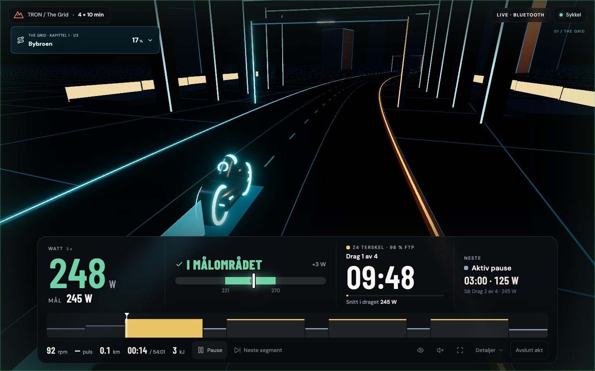 | 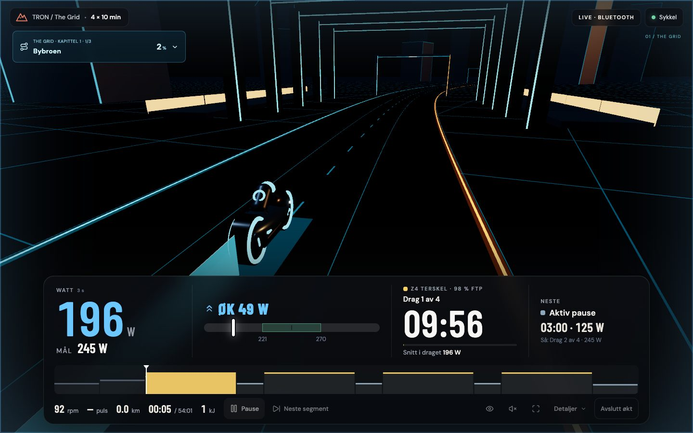 |
| **On target.** Green band, green number, calm edge glow. | **Below target.** The cue tells you exactly how much to add. |
| 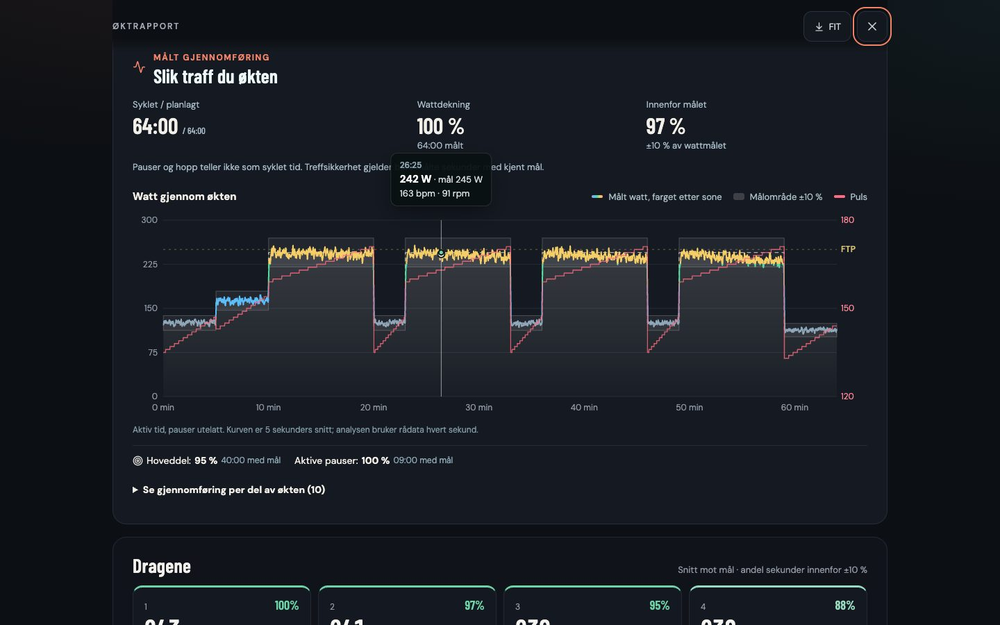 | 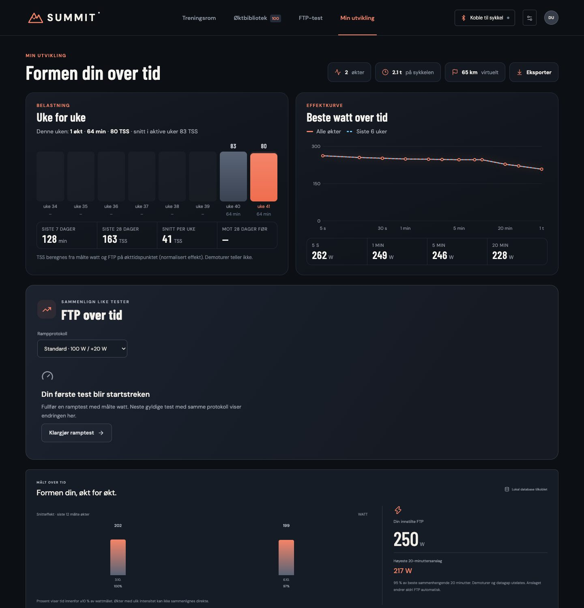 |
| **Ride report.** Zone-coloured power against the target band; hover any second. | **Progress.** Weekly TSS, rolling load and a mean-max power curve. |
| 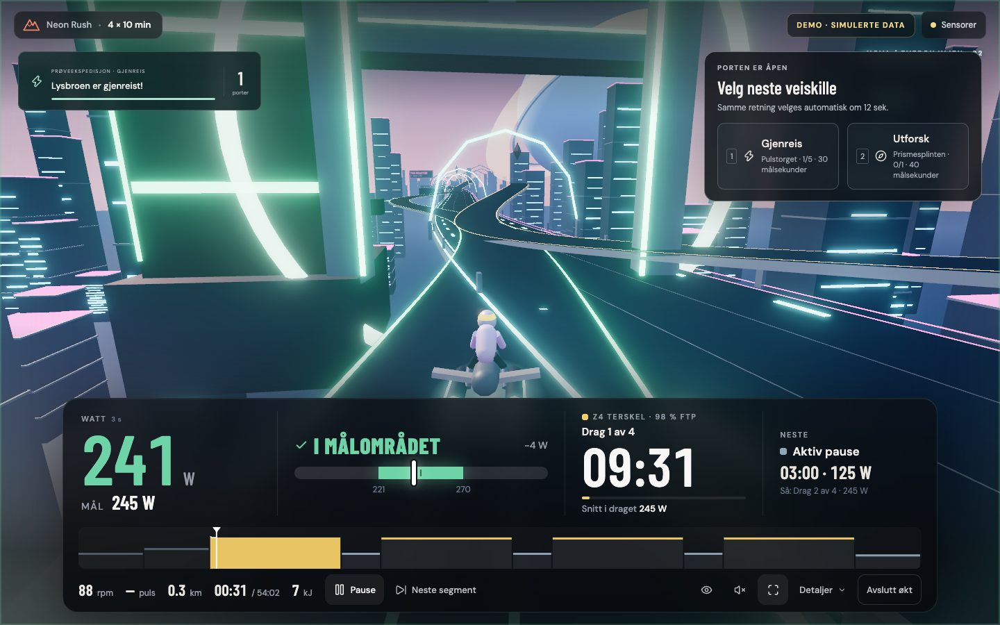 | 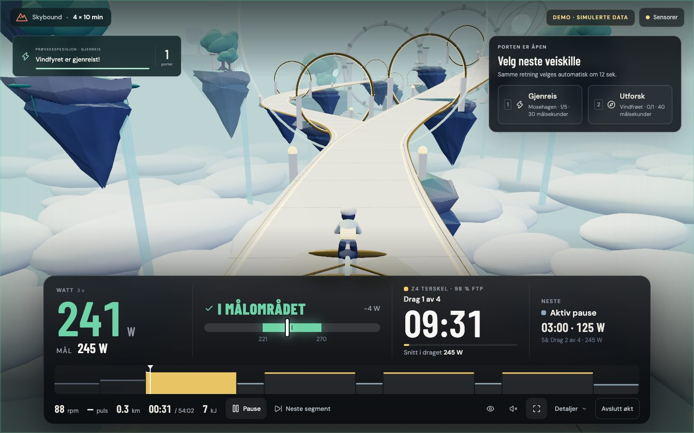 |
| **Neon Rush.** | **Skybound.** |
| 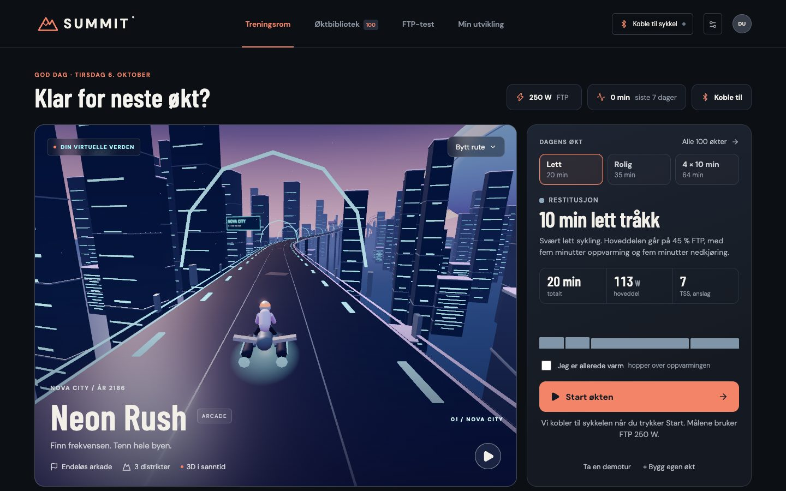 | 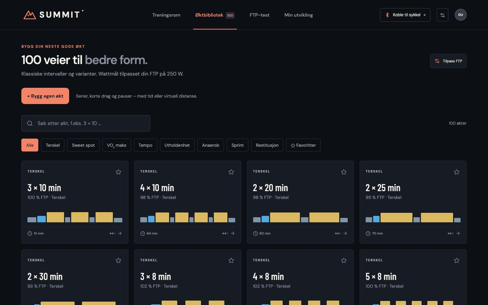 |
| **Home.** Status first, one clear start button. | **Library.** 100 workouts plus your own. |

<p align="center">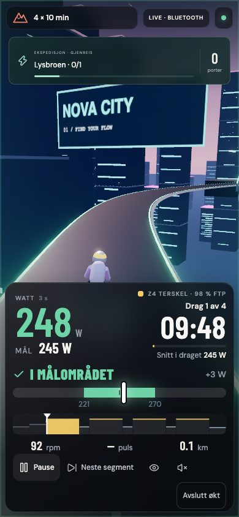</p>

## Quick start

Requires Node **22.13+** (for `node:sqlite`) and Chrome or Edge.

```sh
npm install
npm run dev
```

This starts the local SQLite backend on `127.0.0.1:3001` and the Vite dev server. Open the address Vite prints, press **Start økten**, and choose your bike in the browser's Bluetooth dialog. Without a bike, choose **Ta en demotur** (take a demo ride) to try everything with simulated power.

For a production build served by the local backend:

```sh
npm run build
npm start          # http://127.0.0.1:3001
```

## Hardware and browsers

| | Supported |
|---|---|
| **Bluetooth profiles** | FTMS Indoor Bike Data, Cycling Power, Heart Rate |
| **ANT+** | Power and heart rate via a USB stick and the local Node bridge |
| **Browsers** | Chrome, Edge and other Chromium browsers on Windows, macOS, Linux, ChromeOS and Android |
| **Not supported** | Safari and every iOS browser (no Web Bluetooth in WebKit), Firefox |

The app reads data and does not yet control resistance; you adjust it on the bike. Watts and cadence over Bluetooth have been confirmed on a 2019 Xebex console. Other hardware paths are covered by protocol-level tests with simulated devices.

## How it works

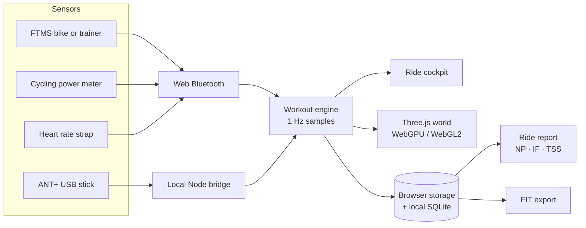

| Area | Where |
|---|---|
| Ride cockpit and target logic | `src/RideConsole.tsx`, `src/cockpit.ts` |
| Workouts, zones and builder | `src/training.ts`, `src/customWorkouts.ts`, `src/workoutRuntime.ts` |
| Bluetooth and sensors | `src/bluetooth.ts`, `src/useSensors.ts`, `server/ant.mjs` |
| Analysis, report and trends | `src/analytics.ts`, `src/reportInsights.ts`, `src/trends.ts`, `src/RideReport.tsx` |
| Worlds | `src/RealWorld.tsx`, `src/TronWorld.tsx`, `src/NeonWorld.tsx`, `src/SkyWorld.tsx`, `src/RideScene.tsx` |
| Storage and FIT | `server/index.mjs`, `server/fit.mjs` |

Design tokens live at the top of `src/styles.css`. The palette, *Nordisk skumring* (Nordic dusk), uses fjord-ink surfaces, warm bone text and a single alpenglow accent. Other colours appear only when they carry meaning.

## Testing

```sh
npm test                         # 200+ unit and backend tests (Vitest)
node scripts/sensor-smoke.mjs    # simulated BLE bike + HR, SQLite, FIT round trip
node scripts/ui-smoke.mjs        # UI flows against a running dev server
```

Nine browser smoke suites (UI, sensors, ramp test, builder, expeditions, journeys, gameplay, Vestlandsveien, The Grid) drive the real app with Playwright. They use isolated, mocked APIs and temporary databases, so personal ride data is never touched.

## Roadmap

- **Resistance control** via the FTMS control point: ERG mode for workouts and slope simulation for the worlds.
- **Fully in-browser hosting:** IndexedDB storage, in-browser FIT encoding, installable PWA and screen wake lock.
- **More sensors:** speed/cadence sensors with clearly labelled estimated power, and a "test your bike" compatibility page.
- **iPad and iPhone** through Web Bluetooth browsers such as Bluefy, and later a native wrapper.

## Status

A personal project in active development. The interface is in Norwegian (bokmål). Detailed technical notes, also in Norwegian, are in [`docs/teknisk-dokumentasjon.md`](docs/teknisk-dokumentasjon.md).

## Credits

[Three.js](https://threejs.org) · [Garmin FIT JavaScript SDK](https://github.com/garmin/fit-javascript-sdk) · [Poly Haven](https://polyhaven.com) (CC0 textures and HDRI, see `public/assets/vestland/credits.json`) · [Lucide](https://lucide.dev) icons · [Barlow Condensed](https://fonts.google.com/specimen/Barlow+Condensed) and [DM Sans](https://fonts.google.com/specimen/DM+Sans). The handlebar foreground in the cockpit view is AI-generated; prompt and provenance are in `public/assets/rider/`.

Built by [@percw](https://github.com/percw) together with AI coding agents (OpenAI Codex and Anthropic Claude Code).

No license has been chosen yet. Until one is added, all rights are reserved.
